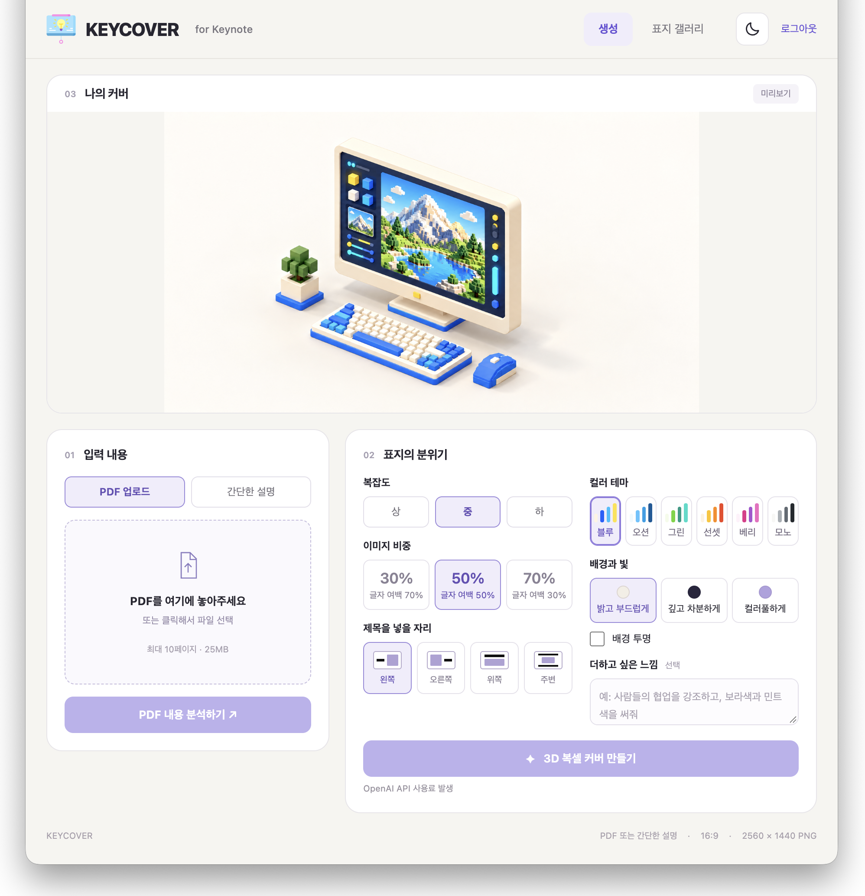
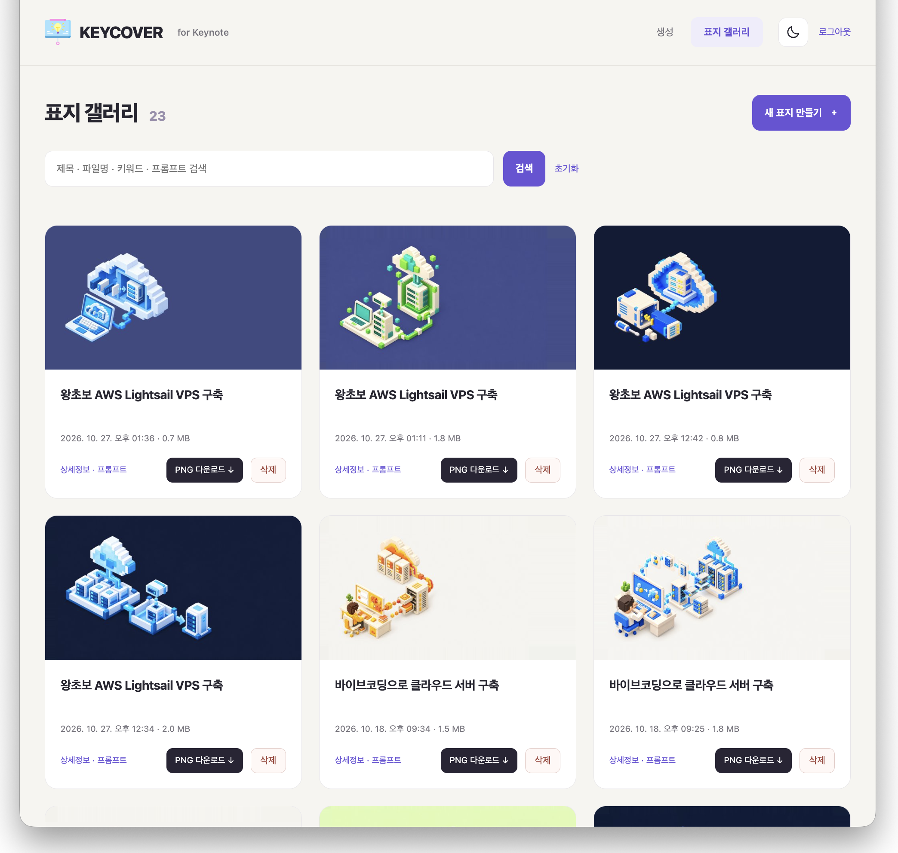

# KeynoteCover

한국어 | [English](README.en.md)

PDF 또는 짧은 설명을 **글자 없는 16:9 3D 복셀 표지**로 만드는 PHP 웹 앱입니다. 제목은 Keynote에서 직접 넣습니다.

- 상단 미리보기, 하단 입력·분위기 설정 2열. 모바일에서는 한 열로 전환합니다.
- PDF 1~10페이지, 최대 25MB. 설명 입력은 최대 2,000자입니다.
- 복잡도, 이미지 비중, 제목 여백, 컬러 테마, 배경색과 투명 PNG를 선택합니다.
- 결과는 2560×1440 PNG이며 내용·배경·글자를 검사합니다. AI 검사가 모든 오류를 찾아낸다는 보장은 없습니다.
- **각 사용자가 자신의 OpenAI API 키로 사용합니다. 공용 키는 제공하지 않습니다.**

## 화면 예시

### 표지 생성

미리보기 아래에서 PDF·설명 입력과 표지의 분위기를 조정합니다. 이미지 비중, 제목 여백, 6가지 컬러 테마와 배경을 선택할 수 있습니다.



### 표지 갤러리

공개한 표지를 검색하고, 상세정보와 생성 프롬프트를 확인하거나 PNG를 내려받습니다.



제공된 이미지는 화면 구성 예시입니다. 이 저장소의 배포판에서는 로그인 대신 각 사용자의 API 키 설정을 사용하며, 갤러리 공개는 선택 사항입니다.

## API 키와 공개 범위

키 입력 후 ‘키 설정’을 누르세요. 형식만 확인하며 실제 키·모델 권한은 첫 OpenAI 요청 때 확인됩니다. 키는 HTTPS로 앱 서버에 전송되고, 서버 세션에 암호화 보관됩니다. 브라우저 저장소, 작업 상태, 생성 프롬프트, 갤러리, 로그에 키를 저장하지 않습니다. 최대 8시간 뒤 만료되며 ‘키 삭제’로 다음 요청부터 사용을 중지할 수 있습니다. 이미 실행 중인 작업은 종료되지 않습니다.

호스팅 서버는 요청을 처리하기 위해 키를 복호화합니다. 자신이 운영하거나 신뢰하는 서버에 설치해 사용하세요. 암호화는 서버 운영자의 접근을 막는 장치가 아닙니다.

기본 설정에서는 결과가 공개 갤러리에 게시되지 않습니다. ‘공개 갤러리에 게시’를 선택하면 **표지, 분석 내용, 파일명, 추가 요청과 생성 프롬프트**가 공개됩니다. 원본 PDF와 API 키는 공개되지 않습니다. 게시한 브라우저 세션에서는 상세 화면의 ‘공개 취소’로 숨기고 되돌릴 수 있습니다.

PDF·작업 데이터는 정리 작업 실행 시 7일 이후 삭제됩니다. 공개한 표지는 별도로 보관합니다. 세션 쿠키가 사라지면 이전 작업의 접근 권한과 공개 취소 권한도 사라집니다.

## 설치

PHP 서버가 필요합니다. **GitHub Pages에서는 PHP와 비동기 작업이 실행되지 않습니다.**

필수 환경: PHP 8.3 이상, cURL, GD, mbstring, Sodium, Poppler(`pdfinfo`, `pdftoppm`), PHP CLI 실행 권한. 외부 JavaScript 라이브러리나 Composer 패키지는 사용하지 않습니다.

Ubuntu 예시:

```sh
sudo apt-get update
sudo apt-get install apache2 libapache2-mod-php php-cli php-curl php-gd php-mbstring poppler-utils
git clone https://github.com/jvisualschool/KeynoteCover.git
cd KeynoteCover
```

1. 웹 서버의 DocumentRoot는 반드시 `public/`로 지정합니다. 저장소 전체를 웹에 노출하지 마세요.
2. HTTPS를 구성하고 `config/apache.conf.example`을 참고해 `KC_ORIGIN`과 `KC_DATA_DIR`을 설정합니다. `KC_ORIGIN`은 경로 없는 정확한 출처(예: `https://cover.example.com`)입니다.
3. 비공개 데이터 디렉터리를 만들고 PHP 실행 계정에만 읽기·쓰기 권한을 줍니다. 앱 소스에는 쓰기 권한을 주지 않습니다.

```sh
sudo install -d -o www-data -g www-data -m 700 /srv/keynotecover-data
sudo a2enmod headers
```

`.env.example`은 환경 변수 목록입니다. PHP가 자동으로 읽는 파일이 아니므로 웹 서버 또는 프로세스 환경에서 설정하세요. 모델은 `KC_TEXT_MODEL`, `KC_IMAGE_MODEL`로 변경할 수 있으며 사용하는 API 프로젝트의 모델 권한이 필요합니다.

정리 작업은 PHP 실행 계정으로 정기 실행하세요. 웹 서버와 같은 데이터 경로를 지정해야 합니다.

```sh
KC_DATA_DIR=/srv/keynotecover-data /usr/bin/php /srv/keynotecover/app/cleanup.php
```

로컬에서만 화면을 확인하려면(HTTP 허용은 루프백 주소에 한정):

```sh
KC_ORIGIN=http://127.0.0.1:8080 KC_PHP_BIN="$(command -v php)" php -S 127.0.0.1:8080 -t public
```

운영 환경에서는 Apache와 HTTPS를 사용하세요. PHP 내장 개발 서버는 `.htaccess`의 정적 파일 보안 헤더를 적용하지 않습니다.

## 비용과 보관

PDF·설명 분석, 구상 갱신, 이미지 생성과 검사에 OpenAI API 사용료가 발생합니다. 검사 결과에 따라 이미지 생성은 한 번의 요청에서 최대 2회 실행됩니다. API 오류나 통신 실패를 자동으로 반복 호출하지 않습니다. 전체 동시 실행은 2개이며 요청 빈도와 일일 횟수를 제한합니다.

키는 브라우저에서 OpenAI로 직접 보내지 않고 서버에서 [Bearer 인증](https://developers.openai.com/api/reference/overview)으로 사용합니다. 이미지 모델의 출력 규격은 [공식 이미지 API 문서](https://developers.openai.com/api/reference/resources/images/methods/edit)를 참고하세요.

## 검사

```sh
bash scripts/check.sh
```

검사는 임시 로컬 서버와 합성 키·합성 데이터만 사용합니다. OpenAI를 호출하지 않습니다. GitHub Actions에서도 같은 검사와 Gitleaks 비밀정보 검사를 실행합니다. 보안 범위와 한계는 [SECURITY.md](SECURITY.md)를 확인하세요.
